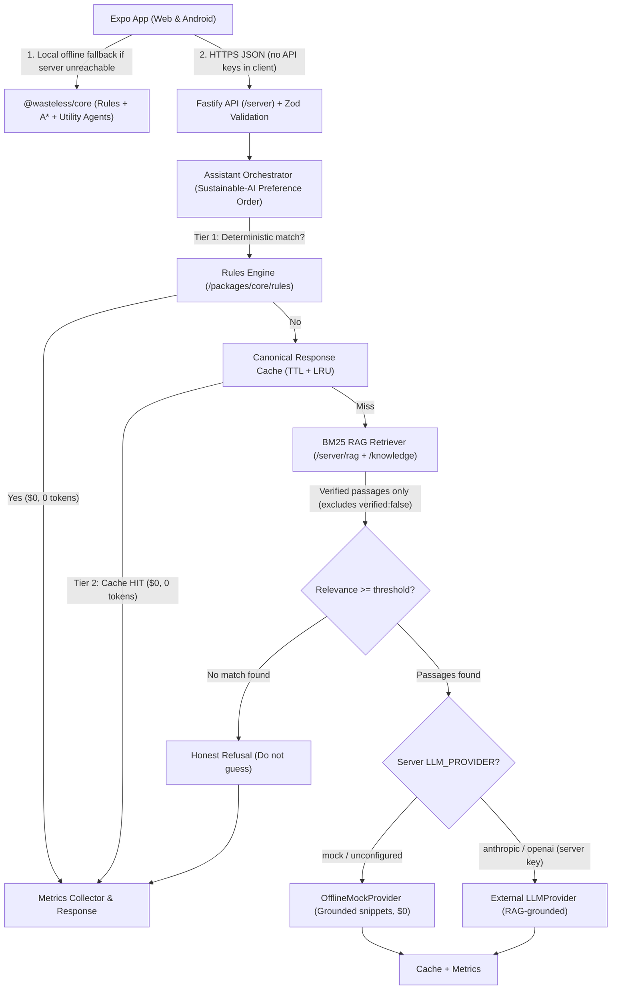

# WasteLess AI — System Architecture

WasteLess AI is a local-first, sustainability-aware food waste reduction assistant built as a TypeScript monorepo:

- **`/packages/core` (`@wasteless/core`)**: Shared domain types, deterministic Rules Engine, A\* Search Planner, 4 Utility Agents, Impact Calculator, and seeded Demo Data. Runs in both the mobile/web app (for offline capability) and the backend API.
- **`/server` (`@wasteless/server`)**: Fastify + TypeScript + Zod API hosting the BM25 RAG retriever, LLM Provider abstraction (`AnthropicProvider`, `OpenAIProvider`, `OfflineMockProvider`), response cache, and Sustainable-AI metrics collector.
- **`/app`**: Expo SDK 58 + React Native + Expo Router + `react-native-web` shared codebase for Android and Web. Talks only to `/server` (never directly to LLM APIs) and stores user state behind a `StorageRepository` interface (`AsyncStorageRepository`).
- **`/knowledge`**: Verified food-safety and sustainability guidance passages (`passages.json` + `SOURCES.md`) with source names, URLs, and retrieval dates.

## Request Resolution & AI Architecture

## Core AI & Sustainability Modules

### 1. Rules Engine (`/packages/core/src/rules`)
- Contains explicit, inspectable rules (`RULE-SAFETY-001..004`, `RULE-URGENT-001..003`, `RULE-PRESERVE-001..003`, `RULE-QUALITY-001..002`), each with `id`, `title`, `conditionDescription`, `actionType`, `actionSummary`, `rationale`, `safetyNote`, and `sourceRef`.
- Strictly separates **"Use by"** (safety deadline) from **"Best before"** (quality guide).
- **Safety invariant**: Rules never declare perishable food safe from appearance or smell alone; uncertain cases (expired `use_by`, refrigerated cooked leftovers > 4 days, opened perishables past window, or power-outage/temperature notes) trigger `"When in doubt, throw it out"` and link to FoodSafety.gov / USDA FSIS guidance.

### 2. A\* Search Planner (`/packages/core/src/planner`)
- Models household "Use soon" decisions as a formal search problem:
  - **State (`PlannerState`)**: remaining at-risk item IDs, addressed/frozen/discarded IDs, remaining cooking minutes, accumulated utility, cost, kg/money/CO2e saved.
  - **Actions (`PlannerAction`)**: `DISCARD_UNSAFE`, `COOK_RECIPE`, `EAT_LEFTOVERS`, `FREEZE_ITEM`, `STORE_PRESERVE`.
  - **Transition**: removes addressed items, deducts minutes, accumulates estimated savings.
  - **Cost & Heuristic**: minimizes step regret + time penalty `g(n)` plus admissible lower bound `h(state) = remainingAtRiskIds.length * 5`, forcing `DISCARD_UNSAFE` first when safety-blocked and favoring multi-item `COOK_RECIPE` synergies.
  - **Goal Test**: `remainingAtRiskIds.length === 0`.
- Returns ordered steps, plain-language explanation, search telemetry (`statesExpanded`, `searchTimeMs`), and `rejectedAlternatives` with reasons why runner-up actions were not selected.

### 3. Utility Agents (`/packages/core/src/agents`)
Four typed modules score outputs using configurable `UtilityWeights` (`urgency`, `wastePrevented`, `costSavings`, `timeEffort`, `preferenceFit`):
- `InventoryAnalyst`: evaluates stock bucket distribution and overall `healthScore` (0–100).
- `ExpiryPrioritizer`: ranks every item by weighted urgency, CO2e/weight at risk, monetary value, handling ease, and goal fit.
- `RecipePlanner`: scores recipes against safe inventory, dietary tags, cooking-time budget, and generates freezing/storage tips, a 3-slot meal plan, and leftover ideas.
- `ActionSelector`: arbitrates safety rules, `ExpiryPrioritizer`, and A\* `ActionPlan`.

### 4. LLM Provider Interface (`/server/src/providers`)
- Unified `LLMProvider` interface (`AnthropicProvider`, `OpenAIProvider`, `OfflineMockProvider`) selected via server environment variables (`LLM_PROVIDER`, `ANTHROPIC_API_KEY`, `OPENAI_API_KEY`).
- Zero API keys exist in `/app` or exported web bundles.

### 5. RAG Knowledge Base (`/knowledge` + `/server/src/rag`)
- Stores passages in `knowledge/passages.json` with `sourceName`, `url`, `retrievalDate`, and `verified`.
- Any passage with `verified: false` is excluded at load time.
- Uses pure TypeScript BM25 retrieval (`k1=1.5`, `b=0.75`) with stopword filtering and a minimum score gate (`RAG_MIN_SCORE`). Unmatched queries return `noMatchFound: true` without guessing.

### 6. Sustainable-AI Metrics (`/server/src/metrics`)
- Records every request's `resolutionTier` (`rules`, `cache`, `rag_llm`, `rag_offline`), `responseTimeMs`, `inputTokens`, `outputTokens`, configurable `estimatedCostUsd`, `cacheHit`, `ruleHandled`, and `ragSourceCount`.
- Surfaces `"X% of requests answered without an LLM"` in Settings and `/api/metrics`.
